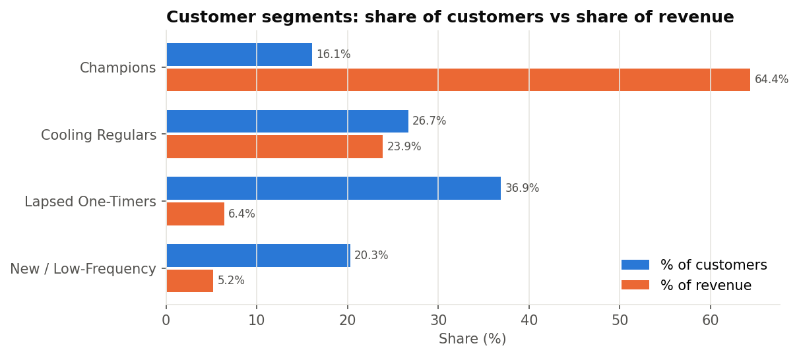
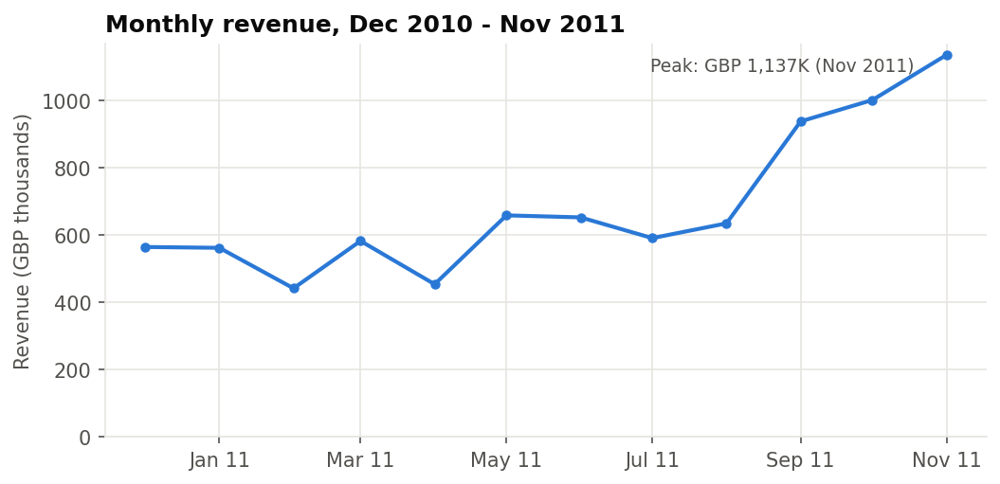
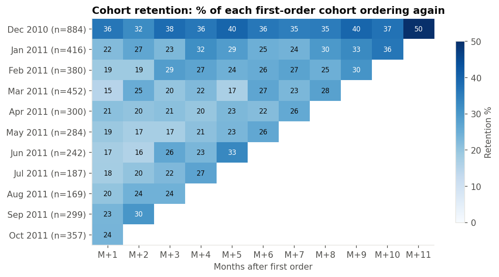
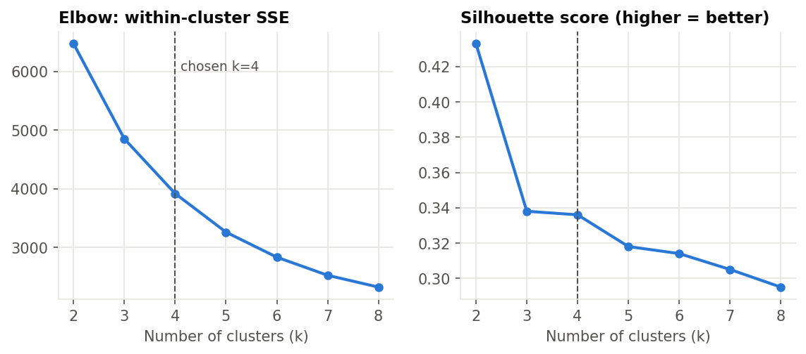

# Customer Segmentation & Retention Analytics (RFM + K-Means)

**Question:** An online gift retailer has 4,300+ customers and £8.7M in annual sales. Which customers actually drive the business, which are slipping away, and where should the marketing budget go?

**Approach:** SQL for cleaning, KPIs, cohort retention and RFM scoring (DuckDB). Python and scikit-learn for K-Means clustering, validated against the rule-based RFM segments.

**Answer:** 16% of customers generate 64% of revenue. A further 27% (the "Cooling Regulars") bring in 24% of revenue but have not ordered in 7–8 weeks, which makes them the highest-value retention target. Only about 1 in 5 new customers orders again the following month.



---

## Data

[UCI Online Retail dataset](https://archive.ics.uci.edu/dataset/352/online+retail) (Chen, Sain & Guo, 2012): every transaction from a UK-based online gift retailer, 1 Dec 2010 to 9 Dec 2011. Many of its customers are wholesalers. It has 541,909 invoice lines across 8 columns: invoice, product, description, quantity, date, unit price, customer ID and country.

A compressed copy is in `data/online_retail.csv.gz`.

## Cleaning (`sql/01_clean.sql`)

| Rule | Why |
|---|---|
| Drop lines with no `CustomerID` (~25% of lines) | They can't be attributed to a customer, so they can't be segmented |
| Drop cancellations (`InvoiceNo` starting with `C`) and quantity ≤ 0 | Returns are measured separately, not netted into purchase behaviour |
| Drop unit price ≤ 0 | Free samples, data errors, bad-debt adjustments |
| Drop non-product codes (`POST`, `M`, `D`, `BANK CHARGES`, `AMAZONFEE`, …) | Postage, manual adjustments and fees are not customer purchases |
| Remove exact duplicate lines | Duplicates would inflate frequency and spend |

**Result:** 391,150 clean line items, 18,402 orders, 4,334 customers, 3,659 products, 37 countries, £8.74M revenue.

## Key business metrics (`sql/02_business_kpis.sql`)

| Metric | Value |
|---|---|
| Average order value | £474.80 |
| Repeat customers (2+ orders) | 65.3% of customers, 92.8% of revenue |
| Top 20% of customers | **74.6% of revenue** (a stronger skew than the classic 80/20) |
| UK share of revenue | 82.9% |
| Cancelled orders | 3,383 orders worth £474K (5.4% of net sales) |
| Seasonality | Nov 2011 revenue (£1.14M) was 2.6× Feb 2011 (£442K), driven by Q4 gifting |



## Cohort retention (`sql/03_cohort_retention.sql`)

Customers are grouped by the month of their first order. Each cell shows the % of that cohort who ordered again *n* months later.

- **Genuinely new customers (Jan–Oct 2011 cohorts) come back the next month only 19.7% of the time**, so roughly 4 in 5 don't place a second order right away.
- The Dec 2010 "cohort" retains about 36%. That is not because December customers are better. The data starts in Dec 2010, so this cohort includes existing regulars whose true first order is not visible (left-censoring). Treat it as a baseline of established customers, not a new cohort.
- December 2011 is excluded because it's a partial month (data ends 9 Dec).



## RFM features (`sql/04_rfm.sql`)

For each customer, measured from 10 Dec 2011 (the day after the last invoice):

- **Recency:** days since their last order
- **Frequency:** number of distinct orders
- **Monetary:** total spend (£)

Each feature is scored 1–5 by quintile, which gives a transparent rule-based segmentation (Champions, Loyal, At Risk, …) to validate the model against.

## K-Means segmentation (`src/segment_customers.py`)

1. **Transform:** RFM is heavily right-skewed (a few wholesalers spend £100K+), so I applied `log1p` and then standardised each feature. Without this, K-Means would effectively cluster on spend alone.
2. **Choose k:** I tried k = 2 to 8.
   - k = 2 has the best silhouette score (0.43), but it only splits "good" from "bad" customers, which isn't actionable.
   - k = 3 and k = 4 are effectively tied on silhouette (0.338 vs 0.336), and the elbow flattens after 4.
   - **k = 4 was chosen** because it separates *new* low-frequency customers from *lapsed* ones. The two need opposite actions: nurture versus low-cost win-back.
3. **Validate:** 95% of the model's Champions are also Champions under the SQL quintile rules. The two methods agree on who matters most (full cross-tab in `outputs/kmeans_vs_rfm_rules.csv`).



### Segments

| Segment | Customers | % of customers | % of revenue | Median days since last order | Median orders | Median spend |
|---|---|---|---|---|---|---|
| **Champions** | 699 | 16.1% | **64.4%** | 9 | 10 | £3,701 |
| **Cooling Regulars** | 1,159 | 26.7% | 23.9% | 53 | 4 | £1,356 |
| **New / Low-Frequency** | 878 | 20.3% | 5.2% | 19 | 2 | £440 |
| **Lapsed One-Timers** | 1,598 | 36.9% | 6.4% | 182 | 1 | £299 |

## Recommendations

1. **Protect the Champions.** 699 customers carry nearly two-thirds of revenue, which is a concentration risk. Give them account-level attention: early access to the Q4 range, volume pricing, and a named contact for the largest wholesale buyers.
2. **Win back Cooling Regulars before they lapse.** This is the biggest lever. These are proven repeat buyers (median 4 orders, £1,356 spend) who have gone quiet for 7–8 weeks. Trigger a reactivation offer when a customer's gap since their last order exceeds their own usual gap.
   - *Illustrative sizing:* holding on to an extra 10% of this segment's annual revenue is worth about **£209K**.
3. **Get new customers to a second order.** About 80% of new customers don't return the following month. Use an onboarding sequence in the first 30 days (a second-order incentive, recommendations based on the first basket), and track month-1 retention as the KPI.
4. **Spend little on Lapsed One-Timers.** They are 37% of customers but only 6% of revenue. Use only low-cost channels such as email, and don't let them absorb budget meant for the segments above.

## Limitations

- Revenue is gross of returns. Cancellations (5.4% of net sales) are reported separately rather than netted per customer.
- There is only about one year of history, and it starts mid-relationship for existing customers, so recency and frequency are understated for long-standing accounts.
- Seasonality (the Q4 peak) inflates the recency advantage of customers who happened to buy in November.
- The £209K figure is an illustrative scenario, not a forecast. A real estimate would need a controlled reactivation test.

## Run it

```bash
pip install -r requirements.txt
python src/run_sql.py            # cleaning, KPIs, cohorts, RFM  -> outputs/*.csv
python src/segment_customers.py  # K-Means, segment profiles    -> outputs/*.csv, outputs/charts/*.png
```

## Repository layout

```
data/online_retail.csv.gz        raw UCI data (compressed)
sql/01_clean.sql                 cleaning rules -> `sales` table
sql/02_business_kpis.sql         AOV, repeat rate, Pareto, monthly trend, countries, cancellations
sql/03_cohort_retention.sql      monthly acquisition cohorts
sql/04_rfm.sql                   RFM features, quintile scores, rule-based segments
src/run_sql.py                   runs the SQL in DuckDB and saves each named query to outputs/
src/segment_customers.py         log-transform, scaling, k selection, K-Means, charts
outputs/                         every result table and chart referenced above
```

**Tools:** SQL (DuckDB), Python, pandas, scikit-learn, Matplotlib
